# Student Performance Prediction with a Neural Network: the complete guide

Everything about the project in plain words: what data we had, what we chose, why, the results, the app, and how to present it.

Kavin Thakur · 24CAI0306 Deep Neural Networks · B.E. CSE-AIML, Semester 5
GitHub: github.com/auraCodesKM/student-performance-dnn · Kaggle: kaggle.com/code/kavinthakurkm/student-performance-dnn

---

## 1. The project in one minute

> "My project predicts whether a school student will **pass** the year or is **at risk of failing**.
> - **Data and inputs.** I used a real dataset of 649 Portuguese students. Each student has 32 pieces of information: family, school, habits and their first two grades. I scored every input and kept the 5 most useful: the two period grades, past failures, the school, and whether the student wants higher education.
> - **Model.** The model is a neural network built in Keras: 5 inputs, two hidden layers of 16 and 8 neurons with ReLU, and one output neuron with sigmoid that gives the chance of failing.
> - **How I chose the settings.** I chose every setting by testing the options with 5-fold cross-validation.
> - **Results.** On 130 students the model had never seen, it is **93.1% accurate** and catches 15 of the 20 failing students. I compared it with logistic regression, a decision tree and a random forest: all are close, and the neural network is the best at finding failing students in cross-validation.
> - **App.** A Streamlit app lets you enter a student and see the prediction with an explanation."

---

## 2. Words you need (full forms)

| Word | Full form / meaning |
|---|---|
| DNN | Deep Neural Network: a neural network with more than one hidden layer (ours has 2) |
| Neuron | One unit that computes: (inputs × weights) + bias, then an activation function |
| Dense layer | A layer where every neuron is connected to every input |
| Hidden layer | A layer between the input and the output |
| Activation function | Adds non-linearity so the network can learn curved patterns |
| ReLU | Rectified Linear Unit: output = max(0, x). Our hidden-layer activation |
| Sigmoid | Output = 1 / (1 + e^−x), always between 0 and 1. Our output activation (gives a probability) |
| tanh | Hyperbolic tangent: output between −1 and 1. Tested, not chosen |
| Loss function | Measures how wrong the predictions are. Training tries to make it small |
| Binary cross-entropy | The loss for yes/no predictions. Our loss |
| Optimizer | The method that updates the weights to reduce the loss |
| SGD | Stochastic Gradient Descent: basic optimizer, same step size for every weight. Tested, not chosen |
| Adam | Adaptive Moment Estimation: an optimizer that adjusts the step size for each weight. Our optimizer |
| Learning rate | How big each weight update is (ours: 0.01) |
| Epoch | One pass through all the training students |
| Batch | A group of students used for one update (ours: 32) |
| Dropout | Randomly switches off neurons during training so the network can't memorise (ours: 40%) |
| Overfitting | Memorising the training students instead of learning general patterns |
| Early stopping | Stop training when the validation loss stops improving, and keep the best weights |
| He initialisation | A way to set the starting weights that suits ReLU (named after Kaiming He) |
| Validation set | Part of the training data used to watch for overfitting during training |
| Test set | Students kept aside and used only once, at the end (ours: 130) |
| Cross-validation (CV) | Split the training students into 5 parts; train on 4, check on 1; repeat 5 times; average |
| Grid search | Try every combination of a few settings and keep the best one |
| One-hot encoding | Turn a text column into 0/1 columns, e.g. school GP/MS becomes `school_MS` = 0 or 1 |
| Standardisation | Rescale a number column: (value − average) ÷ spread |
| Mutual information | Our "information score": how much a column tells us about pass / at risk |
| Accuracy | Share of students predicted correctly |
| Precision | Of the students we flagged AT RISK, how many really failed |
| Recall | Of the students who really failed, how many we flagged |
| F1 score | The balance of precision and recall: 2 × P × R ÷ (P + R) |
| Confusion matrix | A 2 × 2 table of correct and wrong predictions |
| Data leakage | When test data accidentally influences training; it makes results look better than they are |
| UCI | University of California, Irvine: hosts the dataset |
| EDA | Exploratory Data Analysis: looking at the data before modelling |
| CSV | Comma-Separated Values: the data file format |
| Keras | An easy deep-learning library (we run it on top of PyTorch) |
| scikit-learn | A machine-learning library: preprocessing, traditional models, metrics |
| Streamlit | A Python library for making web apps |
| CHO | Course Handout: the course plan |
| G1 / G2 / G3 | 1st-period, 2nd-period and final grade (0–20) |
| GP / MS | The two schools: Gabriel Pereira and Mousinho da Silveira |

---

## 3. The data: what was there

**Source:** UCI Machine Learning Repository, *Student Performance* (P. Cortez and A. Silva, 2008, licence CC BY 4.0). Collected in 2005–06 at two Portuguese secondary schools from school reports and questionnaires.

**Two files:** Portuguese language course (649 students) and Mathematics course (395 students). The brief says use either one.

**All 33 columns:**

| Group | Columns (meaning) |
|---|---|
| Demographic | sex · age (15–22) · address (U = urban, R = rural) · famsize (family size LE3 = 3 or fewer, GT3 = more than 3) · Pstatus (parents T = together, A = apart) · Medu, Fedu (mother's / father's education, 0 = none … 4 = higher education) · Mjob, Fjob (mother's / father's job: teacher, health, services, at home, other) · guardian (mother / father / other) |
| Academic | school (GP / MS) · reason (for choosing the school) · G1, G2 (1st and 2nd period grades, 0–20) · failures (past class failures, 0–3) · studytime (1 = under 2 h … 4 = over 10 h per week) · traveltime (1 = under 15 min … 4 = over 1 h) · schoolsup (extra school support) · famsup (family educational support) · paid (extra paid classes) · nursery (attended nursery school) · higher (wants higher education) |
| Social | famrel (family relationship quality, 1–5) · freetime (1–5) · goout (going out with friends, 1–5) · romantic (in a relationship) · activities (extra-curricular) · internet (at home) |
| Behavioural | absences (0–93) · Dalc (workday alcohol, 1–5) · Walc (weekend alcohol, 1–5) · health (1–5) |
| **Target** | **G3, the final grade (0–20)** |

### Why we used the Portuguese data (the bigger one)

| | Portuguese | Maths |
|---|---|---|
| Students | **649** | 395 |
| Test students (20%) | **130** | 79 |
| Students who fail | 100 (15%) | 130 (33%) |
| Final grade 0 (probably dropped out) | 15 | 38 |

1. **More students means better learning.** A neural network has many weights to learn, so it needs as much data as possible. Portuguese has 64% more students.
2. **A bigger, fairer test.** With 130 test students, one mistake changes accuracy by 0.8%. With 79 it would change it by 1.3%.
3. **Cleaner data.** In Maths, 38 students suddenly got a final grade of 0 (most likely they dropped out). No input can predict that, so it confuses the model. Portuguese has only 15.
4. **Why not combine both?** 382 students are in both files, and there is no student ID. The same person could end up in both training and test, which would be cheating.

### What we found when we looked at the data (EDA)

| Finding | What we did |
|---|---|
| No missing values, no duplicates | Nothing to fill in or remove |
| Only 15.4% fail | Always saying "pass" would already be 84.6% accurate, so we also use recall and F1 |
| 15 students have G3 = 0, all with 0 absences (likely dropped out) | Kept: they really failed |
| G2 is very close to G3 (correlation 0.92) | Grades will be the strongest inputs |
| Some students have many absences (up to 32) | Kept: these are real students, not errors |

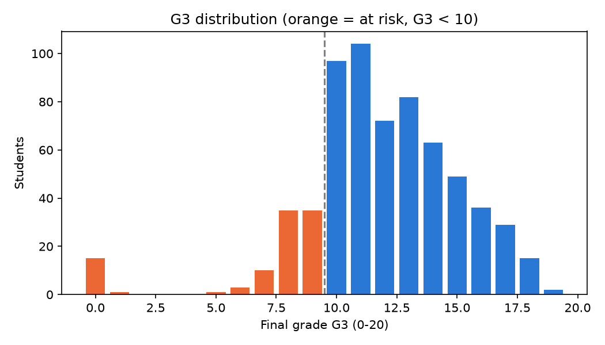

---

## 4. What we chose, and why

| Step | What we did | Why (in simple words) | What we did not do, and why |
|---|---|---|---|
| Target | AT RISK = 1 if G3 < 10, else PASS | 10 out of 20 is the pass mark in Portugal; a school needs a pass/fail decision | Predicting the exact grade: a school acts on pass/fail |
| Split | 80% train (519), 20% test (130), stratified | The test students judge the model fairly because it never sees them while learning | Testing on training data: that shows memory, not skill |
| Text columns | One-hot encoding | The network needs numbers; categories have no order | Numbering categories 0, 1, 2…: that would invent a fake order |
| Number columns | Standardisation | Puts all inputs on a similar scale, so training is stable | Leaving raw values: absences (0–32) would dominate yes/no columns (0–1) |
| Inputs | Top 5 by information score | Tested 5, 10, 20 and all 45 columns: 5 gave the best F1 | Using all inputs: worse (F1 0.643 vs 0.711) and harder to explain |
| Model type | Neural network (multilayer perceptron) | Required by the brief; good for table data | CNN (for images) and RNN/LSTM (for sequences): our data is a simple table |
| Hidden layers | 2 layers: 16 then 8 neurons | Best in the grid search; small enough for 519 students | Bigger layers (32-16): slightly worse |
| Activation | ReLU in hidden layers | Best F1 in our test (0.767; tanh 0.684); simple and fast | Sigmoid in hidden layers was close (0.762) but slightly worse and learns slower in deep networks |
| Output | 1 neuron with sigmoid | Gives a probability between 0 and 1; AT RISK if ≥ 0.5 | Softmax with 2 neurons: same thing for yes/no, more complicated |
| Loss | Binary cross-entropy | The standard loss for yes/no problems | Mean squared error: meant for predicting numbers, not classes |
| Optimizer | Adam | Best F1 in our test (0.767 vs SGD 0.679); adjusts its step size automatically | SGD: learned less well with the same settings |
| Learning rate | 0.01 | Best in the grid search (better than 0.001) | – |
| Dropout | 0.4 | Best in the grid search (better than 0.2); prevents memorising | No dropout: risk of overfitting on small data |
| Starting weights | He initialisation | Designed for ReLU | All zeros: every neuron would learn the same thing |
| Training stop | Early stopping (patience 20) | Stops automatically at the right time and keeps the best weights | A fixed number of epochs: we would have to guess |
| Choosing settings | Grid search + 5-fold cross-validation | Every choice tested fairly on training data only | Choosing by test score: that would be cheating |
| Main score | F1 (plus accuracy) | Only 15% fail; F1 checks we actually find them | Accuracy alone: "always pass" already gets 84.6% |

**No data leakage:** the test students are split off first. Scaling, encoding and feature scores are learned from training students only, inside every cross-validation fold.

---

## 5. The final neural network

```
5 inputs ─► Dense 16 (ReLU) ─► Dropout 40% ─► Dense 8 (ReLU) ─► Dropout 40% ─► Dense 1 (sigmoid) ─► chance of failing
```

| Layer | Neurons | Weights + biases |
|---|---|---|
| Input | 5 (G2, G1, failures, school_MS, higher_yes) | – |
| Dense + ReLU | 16 | 5 × 16 + 16 = **96** |
| Dropout 0.4 | – | 0 |
| Dense + ReLU | 8 | 16 × 8 + 8 = **136** |
| Dropout 0.4 | – | 0 |
| Dense + sigmoid | 1 | 8 × 1 + 1 = **9** |
| **Total** | | **241 parameters** |

**How it learns:**
1. Take a batch of 32 students and predict their chance of failing.
2. Compute the binary cross-entropy loss: how wrong the predictions were.
3. Backpropagation works out how much each weight caused the error.
4. Adam changes every weight a little to reduce the error.
5. Repeat for all batches (one epoch), then check the validation loss.
6. Early stopping: the model trained for 56 epochs and kept the weights from **epoch 36**, the best one.

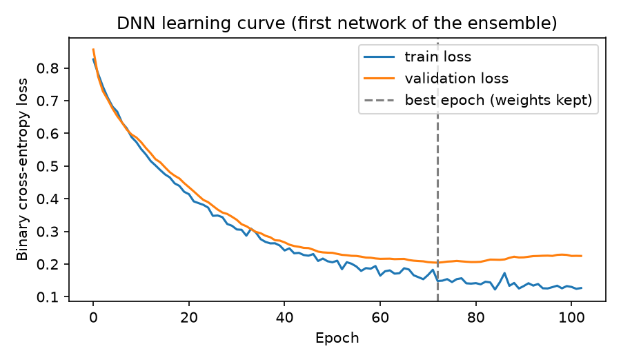

**Reading the curve:** both losses drop quickly, then flatten out, so the network learned. The training loss is a bit higher because dropout is switched on during training.

---

## 6. How every setting was chosen (5-fold cross-validation on the 519 training students)

**A. Number of inputs**

| Columns kept | CV accuracy | CV F1 |
|---|---|---|
| **5 (chosen)** | 0.910 | **0.711** |
| 10 | 0.919 | 0.700 |
| 20 | 0.894 | 0.656 |
| all 45 | 0.896 | 0.643 |

10 columns gave slightly higher accuracy, but we choose by F1 because finding the failing students is the goal. More columns brought in noise and made F1 worse.

**B. Grid search: 8 combinations** (layer sizes × dropout × learning rate)

| Layers | Dropout | Learning rate | CV accuracy | CV F1 |
|---|---|---|---|---|
| **16-8** | **0.4** | **0.01** | **0.925** | **0.767** |
| 32-16 | 0.4 | 0.01 | 0.919 | 0.738 |
| 32-16 | 0.2 | 0.01 | 0.913 | 0.732 |
| 16-8 | 0.2 | 0.01 | 0.910 | 0.715 |
| 32-16 | 0.2 | 0.001 | 0.912 | 0.714 |
| 16-8 | 0.4 | 0.001 | 0.908 | 0.696 |
| 16-8 | 0.2 | 0.001 | 0.900 | 0.688 |
| 32-16 | 0.4 | 0.001 | 0.904 | 0.681 |

**C. Activation function:** ReLU **0.767** (chosen) · sigmoid 0.762 · tanh 0.684 (CV F1)

**D. Optimizer:** Adam **0.767** (chosen) · SGD 0.679 (CV F1)

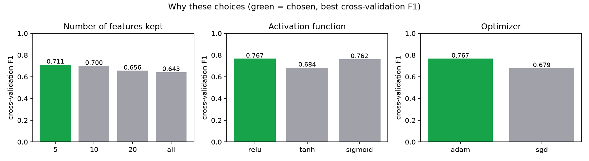

---

## 7. Results

### On the 130 test students (never seen before)

| Accuracy | Precision | Recall | F1 |
|---|---|---|---|
| **93.1%** (121 of 130) | 78.9% | 75.0% | 0.769 |

| | Predicted PASS | Predicted AT RISK |
|---|---|---|
| **Really passed (110)** | **106** correct | 4 false alarms |
| **Really failed (20)** | 5 missed | **15** caught |

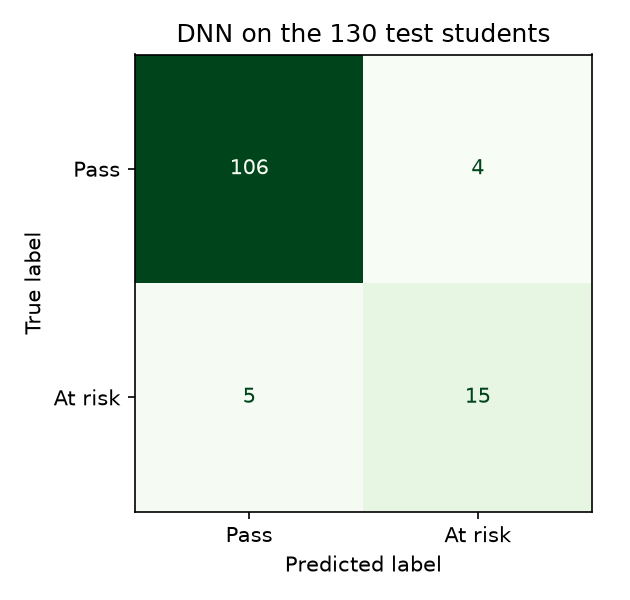

### Comparison with traditional machine learning (the brief asks for at least one; we used three)

| Model | How it works | CV accuracy | CV F1 | CV recall | Test accuracy | Test F1 |
|---|---|---|---|---|---|---|
| **Neural network (ours)** | Layers of neurons | 0.925 | **0.767** | **0.812** | 0.931 | 0.769 |
| Logistic regression | Weighted sum + sigmoid (a network with no hidden layer) | 0.929 | 0.753 | 0.725 | 0.923 | 0.750 |
| Decision tree | A series of yes/no questions | 0.937 | 0.755 | 0.662 | **0.938** | **0.778** |
| Random forest | 300 trees that vote | 0.929 | 0.751 | 0.725 | 0.900 | 0.711 |
| Always say "pass" | No model | – | – | – | 0.846 | 0 |

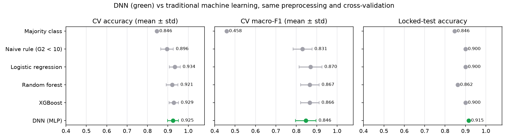

**How to explain this:**
- **It was a fair test:** same students, same 5 inputs, same 5 folds. Each traditional model also got a small grid search of its main setting.
- **In cross-validation,** the fairest comparison, the neural network has the **best F1 and the best recall**. It finds the most failing students (81% vs 66–73%).
- **On the test set,** all models are within a few students of each other. The decision tree is 1 student better on accuracy; with 130 students that is not a real difference.
- **Honest conclusion:** "The neural network is as good as the best traditional models and the best at catching at-risk students. With the grades known, this is a fairly easy problem, so simple models also do well."

---

## 8. Feature choices: why these 5 and not the others

**Method:**
1. Give every one of the 45 columns an **information score** (mutual information), using the training students only.
2. Keep the top 5. Section 6A shows that 5 worked best.

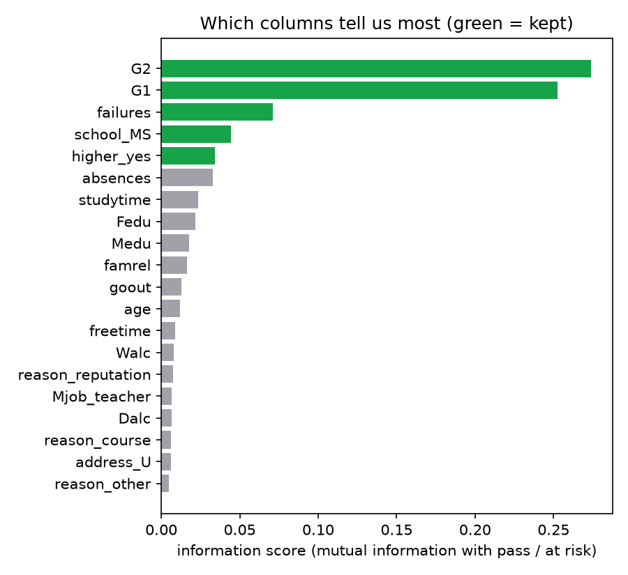

| Input | Used? | Rank | Why |
|---|---|---|---|
| G2 (2nd period grade) | **yes** | 1 | Strongest signal; closest to the final grade (correlation 0.92) |
| G1 (1st period grade) | **yes** | 2 | G1 of 8 or less: 81% fail; 11 or more: almost never |
| failures (past failures) | **yes** | 3 | None: 9% fail; one: 45%; two or more: about 60% |
| school | **yes** | 4 | MS: 31% fail; GP: 7% |
| higher (wants higher education) | **yes** | 5 | No: 46% fail; yes: 12% |
| absences | no | 6 | Many absences fail more (24% vs 14%), but adding more columns didn't help, and absences already show in the grades |
| studytime | no | 7 | Little study goes with low grades, which the model already sees |
| Fedu, Medu (parents' education) | no | 8, 9 | Weaker than the grades |
| famrel (family relations) | no | 10 | Very bad relations: 42% fail, but only 19 students |
| goout, freetime | no | 11, 13 | Weak signals |
| age | no | 12 | Older students failed before, which "failures" already captures |
| Walc, Dalc (alcohol) | no | 14, 17 | Small effect, already reflected in grades |
| reason, Mjob, Fjob, guardian | no | 15–24 | Small differences; jobs overlap with parents' education |
| **address** | no | 19 | See the example below |
| traveltime, internet | no | 22, 26 | Mostly repeat address and school |
| romantic, activities, sex, health | no | 25–29 | Weak, and disappear once grades are known |
| famsup, famsize, schoolsup, nursery, Pstatus, paid | no | 33–41 | Almost no difference between groups |

**Address example (if sir asks "why not address?"):**

> "Rural students do fail more often: 21% vs 13%. But rural students also have lower grades, and most go to the MS school, which the model already knows. If you compare students with the **same G2 grade**, rural and urban students fail at about the same rate. So once we know the grades, address tells us nothing new, and its information score ranks only 19 of 45."

| Same G2 grade | Rural fail rate | Urban fail rate |
|---|---|---|
| 8 or less | 92% | 91% |
| 9 | 36% | 29% |
| 10 | 15% | 10% |
| 11 or more | 0% | 0% |

**General answer for any unused input:** "It has a lower information score than the top 5. Most of what it tells us is already in the grades, and adding more inputs made the model worse in cross-validation."

---

## 9. The Streamlit app

**Start it:**
```
cd ~/Desktop/DNN
source .venv/bin/activate
streamlit run app.py
```
It opens at http://localhost:8501. Reload the page (Cmd + R) to reset all inputs.

**How it works:** the app loads the saved preprocessor (`models/preprocessor.joblib`) and the saved network (`models/dnn.keras`). When you change an input, it runs the student through the same encoding, scaling and column selection as in training, and the network gives the chance of failing. Nothing is retrained.

### Tab 1: Predict

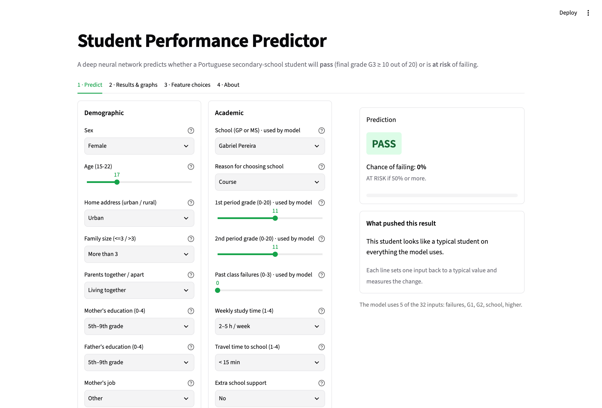

- **The form:** all 32 inputs in the brief's 4 groups (Demographic, Academic, Social, Behavioural). The 5 inputs the model uses are marked "used by model", and each input has a (?) tooltip saying why it is or isn't used.
- **The result panel:** PASS (green) or AT RISK (red), the chance of failing, and a note when it is close to 50%.
- **"What pushed this result":** for each used input that differs from a typical student, it sets that input back to typical and shows how much the chance changes.

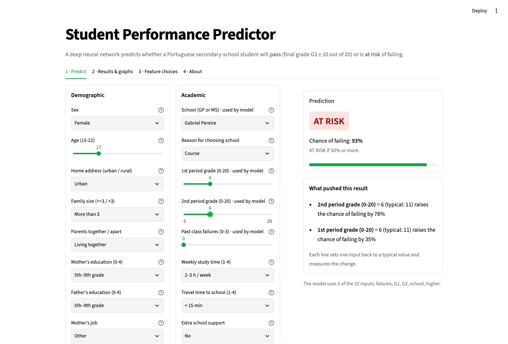

### Tab 2: Results & graphs

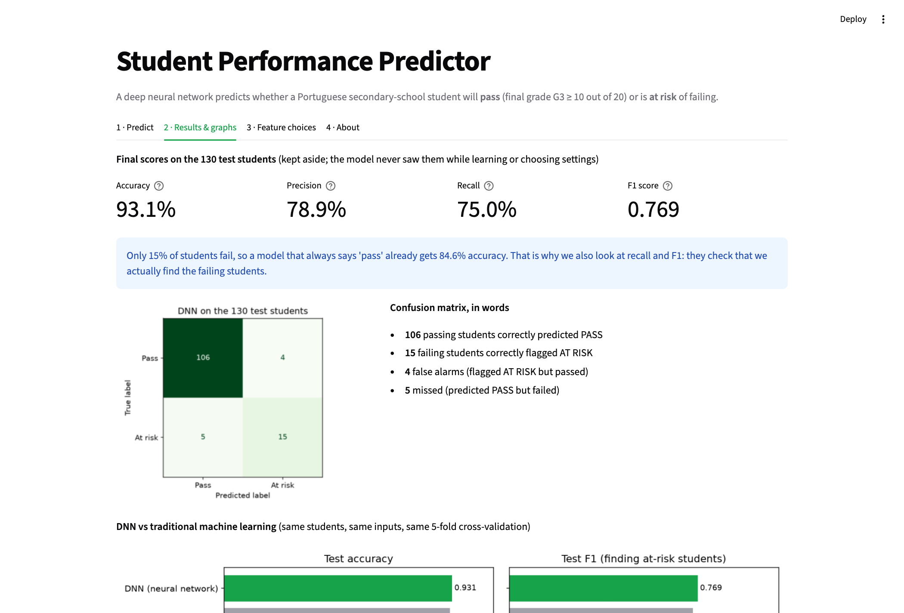

Test scores, the confusion matrix in words, the comparison with traditional ML (graph and table), the "why these choices" graph, the learning curve, and a table of the final network settings.

### Tab 3: Feature choices

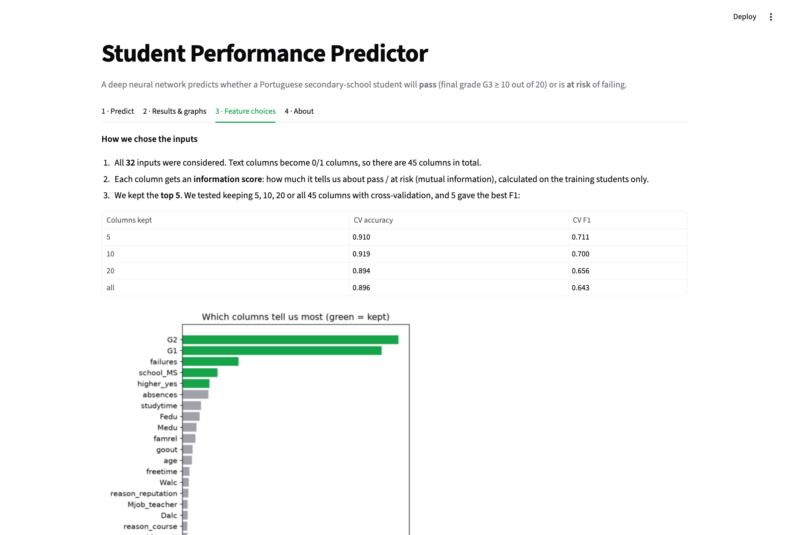
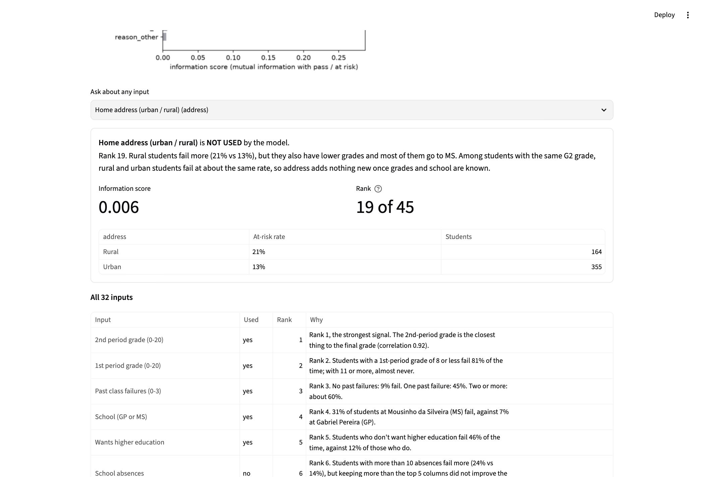

How the inputs were chosen, the 5 / 10 / 20 / all table, the information-score graph, an **"Ask about any input"** box (shows used / not used, reason, score, rank and fail rate per value), and a table of all 32 inputs.

### Tab 4: About

Project, data source, method, and a responsible-use note.

---

## 10. How to present (about 10 minutes)

| Time | Say / show |
|---|---|
| 0:00–1:00 | **The problem:** predict pass / at risk so teachers can help early. Read the one-minute summary (section 1). |
| 1:00–2:30 | **The data:** UCI, 649 students, 32 inputs in 4 groups, target G3. Why Portuguese (section 3). EDA: 15% fail, no missing values. |
| 2:30–4:00 | **Preparing the data:** 80/20 split, one-hot encoding, standardisation, information score, top 5 inputs. |
| 4:00–5:30 | **The neural network:** draw 5 → 16 → 8 → 1; ReLU, dropout, sigmoid, binary cross-entropy, Adam, early stopping (sections 4–5). |
| 5:30–6:30 | **How settings were chosen:** grid search and the three tests (inputs, activation, optimizer) with cross-validation. Show the "why these choices" graph. |
| 6:30–9:00 | **App demo:** Tab 1, then Tab 2, then Tab 3 (steps below). |
| 9:00–10:00 | **Conclusion and limits:** 93.1% test accuracy, best at finding at-risk students in cross-validation, as good as traditional models; small data, misses 1 in 4 failing students. |

### Demo steps (checked in the running app)

| Step | Do this | You will see |
|---|---|---|
| 1 | Open Tab 1, leave the defaults | **PASS**, 0% chance of failing |
| 2 | Set G1 = 6 and G2 = 6 | **AT RISK**, 93%; "2nd period grade raises the chance by 78%" |
| 3 | Reload; set G1 = 9, G2 = 9 | PASS, 30% |
| 4 | Change "Wants higher education" to No | PASS, 39% (close to 50%: uncertain) |
| 5 | Change school to Mousinho da Silveira | **AT RISK, 57%**: other factors tipped a borderline student |
| 6 | Hover the (?) next to "Home address" | The reason it isn't used |
| 7 | Open Tab 2 | Test scores, confusion matrix, comparison, choices graph |
| 8 | Open Tab 3, "Ask about any input" → address | The full answer for address |

---

## 11. Questions sir may ask

| Question | Answer |
|---|---|
| Why the Portuguese dataset? | More students (649 vs 395) for the neural network to learn from, a bigger test set (130 vs 79), and fewer dropouts with a grade of 0 (15 vs 38). Can't merge: 382 students are in both files. |
| What does the model predict? | The chance that the final grade G3 is below 10 out of 20. AT RISK if the chance is 50% or more. |
| What is your accuracy? | 93.1% on 130 test students the model never saw (121 correct). |
| Why not only accuracy? | Only 15% fail, so "always pass" already gets 84.6%. F1 and recall check that we find the failing students. |
| Why only 5 inputs? | We tested 5, 10, 20 and all 45 columns with cross-validation; 5 gave the best F1. Fewer inputs also means less noise and a simpler model. |
| Why not address (or any other input)? | Lower information score. For address: with the same grades, rural and urban students fail at the same rate. |
| Isn't using G1 and G2 cheating? | No. They are known before the final grade (after the 1st and 2nd terms), so a teacher has them when using the model. |
| Why a neural network? | The brief asks for a DNN; it learns patterns from the data by itself. |
| Why 2 hidden layers of 16 and 8? | Best of the grid search. Small enough for 519 students without memorising them. |
| Why ReLU? | Best F1 in our test (0.767 vs tanh 0.684). It is simple (max(0, x)) and doesn't slow learning the way sigmoid and tanh can. |
| Why sigmoid at the output? | It gives a number between 0 and 1, which we read as the chance of failing. |
| Why binary cross-entropy? | It is the standard loss for yes/no predictions: it heavily punishes confident wrong answers. |
| Why Adam and not SGD? | Better F1 in our test (0.767 vs 0.679). Adam adjusts the step size for each weight automatically. |
| What does dropout do? | During training it randomly switches off 40% of neurons, so the network can't rely on any single one and doesn't memorise. |
| What is early stopping? | We watch the validation loss; when it hasn't improved for 20 epochs we stop and keep the best weights (epoch 36). |
| What is cross-validation? | Split the training students into 5 parts; train on 4 and test on 1; repeat 5 times; average. Every student is tested once. |
| What is a grid search? | Trying every combination of a few settings (here 2 × 2 × 2 = 8) and keeping the best. |
| How did you avoid data leakage? | The test set is split off first; scaling and feature scores are learned only from training students; settings are chosen only by cross-validation. |
| How many parameters? | 241 (96 + 136 + 9). |
| Is the network better than the traditional models? | As good, and the best at finding failing students in cross-validation (recall 0.81). On the test set the decision tree is 1 student better, which is not a real difference. |
| Why is training loss above validation loss? | Dropout is on during training, which makes training harder; it is off when checking validation. |
| What are the confusion-matrix numbers? | 106 passes correct, 15 failing students caught, 4 false alarms, 5 missed. |
| Why does the model miss 5 failing students? | 4 of them were borderline: mid-year grades of 8–12 and a final grade of 8 or 9, just under the pass mark. 1 had grades of 10 and 10, then scored 1 in the final, most likely because they dropped out. No input shows that in advance. |
| How does the app use the model? | It loads the saved preprocessor and network and applies exactly the training steps. It never retrains. |
| What would you improve? | More students and years, more inputs such as attendance over time, and a lower threshold if the school wants to catch more students. |

---

## 12. Limitations (say these honestly)

- **Small data:** only 649 students from 2 schools in one year.
- **Missed students:** it misses 1 in 4 failing students (recall 75%).
- **Grades:** it relies mostly on the grades, so it works best after the 2nd grading period.
- **Sensitive inputs:** the data includes sensitive inputs. The model should start a conversation with a student, never decide anything about them.
