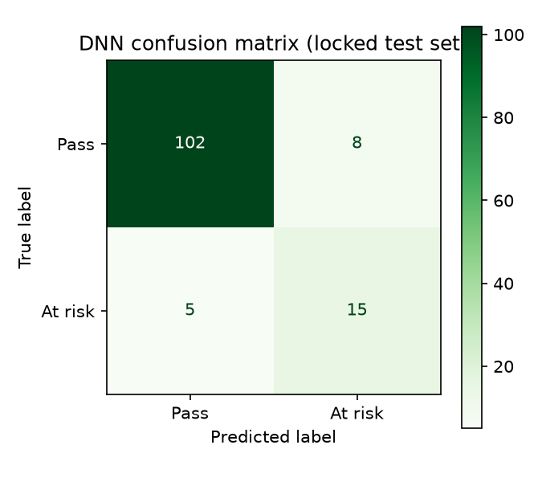
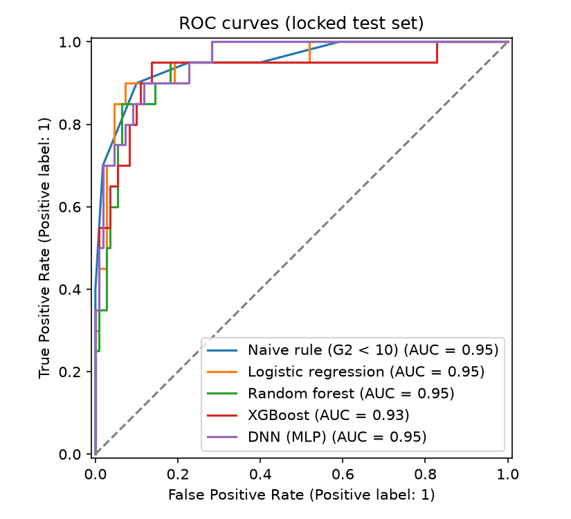

# Results

Portuguese dataset, 649 students. Target: at risk = G3 < 10. 519 training students, 130 locked test students.
**CV** = 5-fold x 3 repeats on the 519 training students. **Test** = the 130 locked students, scored once.

| Model | CV accuracy | CV macro-F1 | CV at-risk recall | CV ROC-AUC | Test accuracy | Test precision | Test recall | Test macro-F1 | Test ROC-AUC |
|---|---|---|---|---|---|---|---|---|---|
| Majority class | 0.846 ± 0.001 | 0.458 ± 0.000 | 0.000 | 0.500 | 0.846 | 0.000 | 0.000 | 0.458 | 0.500 |
| Naive rule (G2 < 10) | 0.896 ± 0.031 | 0.831 ± 0.046 | 0.887 | 0.963 | 0.900 | 0.621 | 0.900 | 0.837 | 0.953 |
| Logistic regression | 0.912 ± 0.027 | 0.851 ± 0.043 | 0.883 | 0.969 | 0.892 | 0.600 | 0.900 | 0.827 | 0.946 |
| Random forest | 0.921 ± 0.029 | 0.867 ± 0.045 | 0.908 | 0.974 | 0.862 | 0.531 | 0.850 | 0.784 | 0.946 |
| XGBoost | 0.929 ± 0.023 | 0.866 ± 0.045 | 0.804 | 0.971 | 0.900 | 0.640 | 0.800 | 0.825 | 0.925 |
| DNN (MLP) | 0.919 ± 0.036 | 0.835 ± 0.077 | 0.679 | 0.967 | 0.900 | 0.652 | 0.750 | 0.819 | 0.953 |

## DNN on the locked test set

- Saved model (used by the app): accuracy 0.900, Wilson 95% CI 0.836–0.941, bootstrap 95% CI 0.846–0.946.
- 5 retrained copies (seeds 0, 100, 200, 300, 400): accuracy 0.912 ± 0.004, macro-F1 0.843 ± 0.009. This spread measures only the random start, not the small test set.
- Confusion matrix: 102 true pass, 8 false alarms, 5 missed at-risk, 15 caught at-risk.

```
              precision    recall  f1-score   support

        Pass      0.953     0.927     0.940       110
     At risk      0.652     0.750     0.698        20

    accuracy                          0.900       130
   macro avg      0.803     0.839     0.819       130
weighted avg      0.907     0.900     0.903       130
```

McNemar exact test, DNN vs each model on the same 130 students (p < 0.05 would mean a real difference):

| Compared with | Only DNN right | Only other right | p-value |
|---|---|---|---|
| Majority class | 15 | 8 | 0.210 |
| Naive rule (G2 < 10) | 5 | 5 | 1.000 |
| Logistic regression | 5 | 4 | 1.000 |
| Random forest | 7 | 2 | 0.180 |
| XGBoost | 3 | 3 | 1.000 |

Selected features (10): school_MS, Pstatus_T, schoolsup_yes, higher_yes, Fedu, studytime, failures, famrel, G1, G2.
Hyperparameters: `{'n_layers': 3, 'width': 64, 'dropout': 0.16199217271219457, 'batchnorm': True, 'lr': 0.0009152887329124827, 'weight_decay': 1.7588952092273983e-05, 'batch_size': 64, 'class_weight': False, 'k': 10}`; best epoch 73.

 

