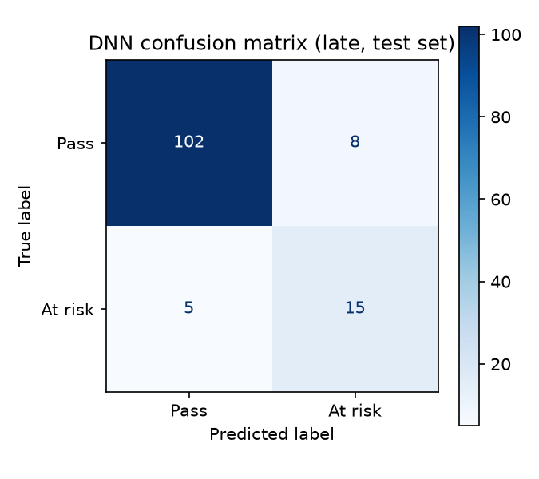
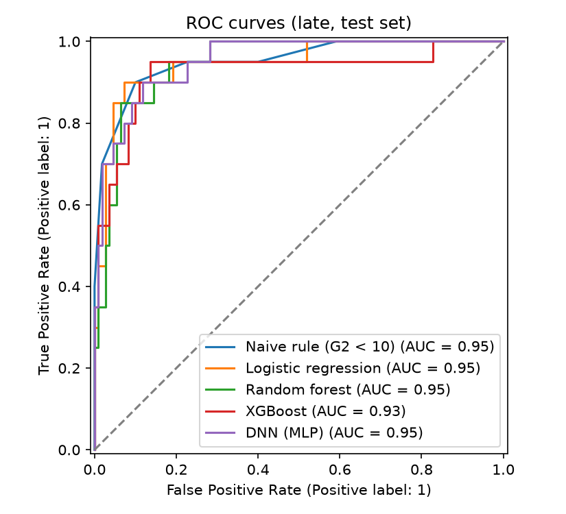
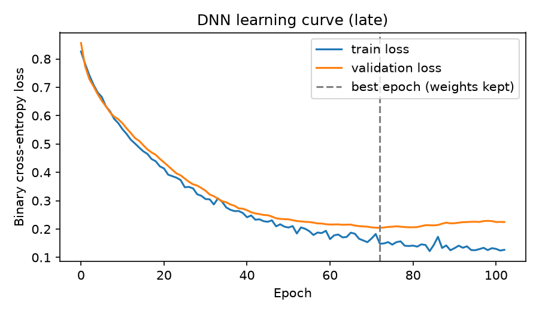
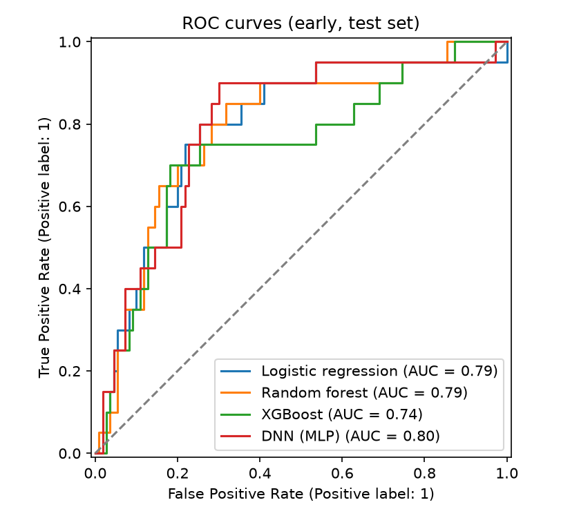
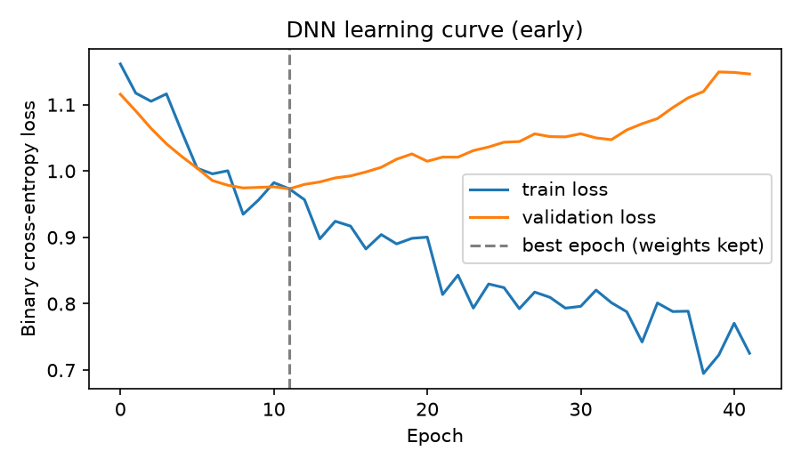

# Results

Portuguese dataset, target = at risk (G3 < 10). 519 training students, 130 locked test students.
CV = 5-fold x 3 repeats on the training set. Test = scored once.

## Late-term (with G1, G2)

| Model | CV macro-F1 | CV accuracy | CV at-risk recall | Test accuracy | Test macro-F1 | Test at-risk recall | Test ROC-AUC |
|---|---|---|---|---|---|---|---|
| Majority class | 0.458 ± 0.000 | 0.846 | 0.000 | 0.846 | 0.458 | 0.000 | 0.500 |
| Naive rule (G2 < 10) | 0.831 ± 0.046 | 0.896 | 0.887 | 0.900 | 0.837 | 0.900 | 0.953 |
| Logistic regression | 0.851 ± 0.043 | 0.912 | 0.883 | 0.892 | 0.827 | 0.900 | 0.946 |
| Random forest | 0.867 ± 0.045 | 0.921 | 0.908 | 0.862 | 0.784 | 0.850 | 0.946 |
| XGBoost | 0.866 ± 0.045 | 0.929 | 0.804 | 0.900 | 0.825 | 0.800 | 0.925 |
| DNN (MLP) | 0.835 ± 0.077 | 0.919 | 0.679 | 0.900 | 0.819 | 0.750 | 0.953 |

DNN over 5 seeds (test): accuracy 0.912 ± 0.004, macro-F1 0.843 ± 0.009.
Bootstrap 95% CI (saved model): accuracy 0.846–0.946, macro-F1 0.719–0.904.
Selected features (10): school_MS, Pstatus_T, schoolsup_yes, higher_yes, Fedu, studytime, failures, famrel, G1, G2.
Hyperparameters: `{'n_layers': 3, 'width': 64, 'dropout': 0.16199217271219457, 'batchnorm': True, 'lr': 0.0009152887329124827, 'weight_decay': 1.7588952092273983e-05, 'batch_size': 64, 'class_weight': False, 'k': 10}`; best epoch 73.

 

## Early-warning (no grades)

| Model | CV macro-F1 | CV accuracy | CV at-risk recall | Test accuracy | Test macro-F1 | Test at-risk recall | Test ROC-AUC |
|---|---|---|---|---|---|---|---|
| Majority class | 0.458 ± 0.000 | 0.846 | 0.000 | 0.846 | 0.458 | 0.000 | 0.500 |
| Logistic regression | 0.685 ± 0.035 | 0.808 | 0.596 | 0.785 | 0.642 | 0.500 | 0.791 |
| Random forest | 0.721 ± 0.041 | 0.855 | 0.521 | 0.838 | 0.653 | 0.350 | 0.790 |
| XGBoost | 0.711 ± 0.045 | 0.838 | 0.567 | 0.808 | 0.652 | 0.450 | 0.743 |
| DNN (MLP) | 0.687 ± 0.033 | 0.795 | 0.671 | 0.762 | 0.622 | 0.500 | 0.797 |

DNN over 5 seeds (test): accuracy 0.803 ± 0.020, macro-F1 0.672 ± 0.032.
Bootstrap 95% CI (saved model): accuracy 0.685–0.831, macro-F1 0.520–0.712.
Selected features (20): school_MS, famsize_LE3, Mjob_teacher, Fjob_other, reason_home, guardian_other, schoolsup_yes, famsup_yes, paid_yes, higher_yes, internet_yes, romantic_yes, age, Medu, traveltime, failures, freetime, goout, Dalc, health.
Hyperparameters: `{'n_layers': 3, 'width': 16, 'dropout': 0.1255700596373297, 'batchnorm': False, 'lr': 0.0013624140903810116, 'weight_decay': 0.004701002013683422, 'batch_size': 32, 'class_weight': True, 'k': 20}`; best epoch 12.

 

